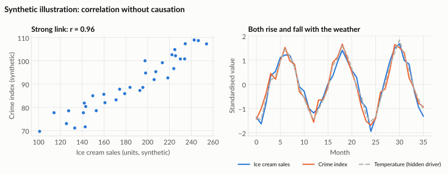
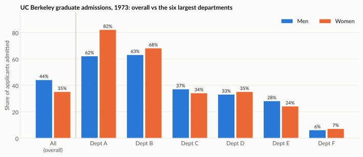
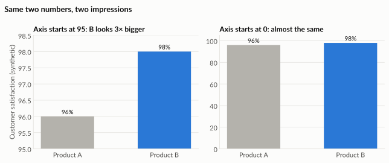
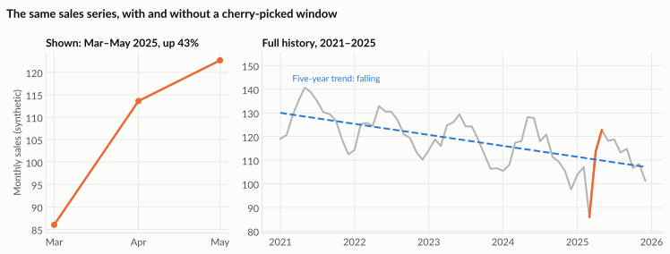
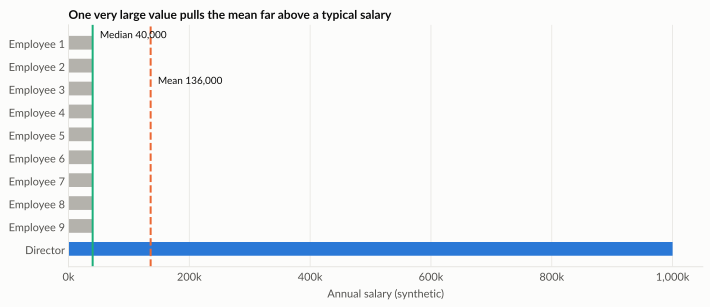
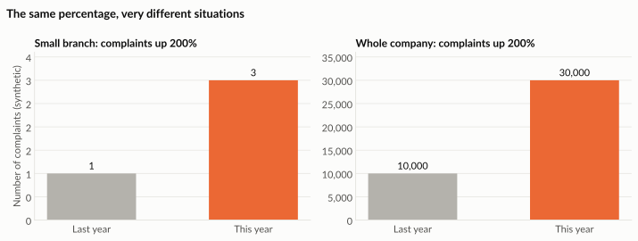

# How statistics can mislead

Numbers feel objective, but the same data can support very different stories depending on how it is summarised, compared and drawn. Learn the common traps so you never fall into them, and can spot them in other people's work.

In 1954, Darrell Huff wrote a short, famous book called *How to Lie with Statistics*. Its point was not to teach lying. It was to show readers how easily numbers mislead, often by accident. The traps below are the ones you will meet most often at work.

---

## 1. Correlation is not causation

Two things that move together are **correlated**. That does not mean one **causes** the other.

A classic example: in many cities, **ice cream sales** and **crime** both rise in summer and fall in winter. Plot one against the other and you see a strong relationship. Does ice cream cause crime? Of course not. Both are plausibly driven by a third factor, **warm weather**, when more people are outside.

*The chart uses synthetic data made up for illustration.*

The hidden third factor is called a **confounder**. Whenever you see two things moving together, ask:

1. Could a third factor be driving both?
2. Could the cause run the other way?
3. Could it be coincidence, especially if I searched through many variables?

!!! note "Spurious correlations"

    If you compare enough unrelated series, some will match by pure chance. Tyler Vigen's *Spurious Correlations* project collects amusing examples, such as films featuring a particular actor tracking the number of swimming-pool drownings in the same years.

!!! warning "At work"

    *"Customers who used our app spent 30% more."* Perhaps the app made them spend more. Or perhaps the customers who already spent the most were the ones who bothered to download the app. Only a fair comparison or a test can tell you which.

---

## 2. Simpson's paradox: the total can reverse the parts

In 1973, the University of California, Berkeley, looked at graduate admissions. Overall, **44% of men** but only **35% of women** were admitted. It looked like clear bias against women.

But when the figures were split by department, the picture changed. The chart and table show the six largest departments; the overall row covers all departments.

| Department | Men admitted | Women admitted |
|---|---|---|
| A | 62% | 82% |
| B | 63% | 68% |
| C | 37% | 34% |
| D | 33% | 35% |
| E | 28% | 24% |
| F | 6% | 7% |
| **All departments (overall)** | **44%** | **35%** |

**What happened?** Women applied mostly to departments that were very competitive for *everyone* (C to F). Men applied mostly to departments that admitted many applicants (A and B). The overall rate mixed together very different groups.

!!! tip "The lesson"

    Before comparing two overall rates, check whether the groups being compared have a different **mix** underneath. A total can tell the opposite story to every one of its parts.

---

## 3. Misleading axes

The same two numbers can look dramatically different depending on where the axis starts.

*Synthetic data for illustration.*

- **Bar charts** should start at zero, because we judge bars by their length.
- **Line charts** may start elsewhere, because we judge lines by their slope, but label the axis clearly.
- Watch for **two different y-axes** on one chart. They let the author make any two lines appear to move together.

---

## 4. Cherry-picked time windows

Choose the start and end dates carefully and almost any trend can be made to look like growth or decline.

- *"Sales up 40% since March!"* (March was the worst month in five years.)
- *"Complaints halved this quarter!"* (Last quarter included a one-off system outage.)

*Synthetic data for illustration.* The left chart is true, but the right chart shows the real story: March was an unusual low, and sales have been falling for five years.

!!! tip "Ask"

    Why does the chart start and end *there*? What does the longer history look like?

---

## 5. Which average?

The word "average" can mean different things:

- The **mean** adds everything up and divides by the count.
- The **median** is the middle value when everything is sorted.

If a few values are extremely large, the mean is pulled upward. Imagine nine employees earning 40,000 and one director earning 1,000,000. The **mean** salary is 136,000; the **median** is 40,000. Both are "the average salary", but only one describes a typical employee.

*Synthetic data for illustration.*

!!! tip "Which to use"

    Use the **median** for things with a few very large values, such as salaries, house prices or delivery delays. Report both when the difference matters.

---

## 6. Percentages without the base

*"Complaints rose 200%!"* sounds alarming. From 1 to 3, it is not. From 10,000 to 30,000, it is a crisis.

*Synthetic data for illustration.* Notice that the two charts look exactly the same. Only the axis numbers reveal how different the situations are.

- Always ask for the **count** behind a percentage.
- Be wary of averaging percentages from groups of very different sizes. You will meet this trap in the marketing case.

---

## 7. Survivorship bias

As the story is usually told, during the Second World War analysts studied bombers returning from missions and mapped where they had been hit. The obvious idea was to add armour where the bullet holes were.

The statistician **Abraham Wald** pointed out the flaw: these were the planes that **survived**. Planes hit in other places, such as the engines, never came back to be counted. The armour belonged where the returning planes had **no** holes.

*Simplified illustration, not real wartime data.*

!!! warning "At work"

    Surveying only current customers about why they like you tells you nothing about why others left. Studying only successful projects hides the reasons projects fail.

---

## A checklist for any number you are shown

Before you trust a figure, ask:

1. **Compared to what?** A number without a comparison means little.
2. **Who or what is included?** Which records, which dates, which filters?
3. **What is the denominator?** Out of how many?
4. **Could something else explain it?** A confounder, a different mix, chance?
5. **How is it drawn?** Where does the axis start? Is the time window fair?

---

## Try it yourself

!!! hint "Exercise 1: name the confounder"

    For each claim, suggest a third factor that could explain the link:

    1. Towns with more fire engines have more fire damage.
    2. Employees who attend more training get promoted more often.
    3. Stores with more staff have more customer complaints.

!!! hint "Exercise 2: fix the chart"

    Find a chart in a news article or a company report. Check where its axis starts, which time period it covers and whether the counts behind its percentages are shown. Rewrite its headline so it is fair.

!!! hint "Exercise 3: spot the paradox"

    A sales manager says: *"Team A's overall conversion rate is lower than Team B's, so Team A is weaker."* What extra breakdown would you ask for before agreeing?
