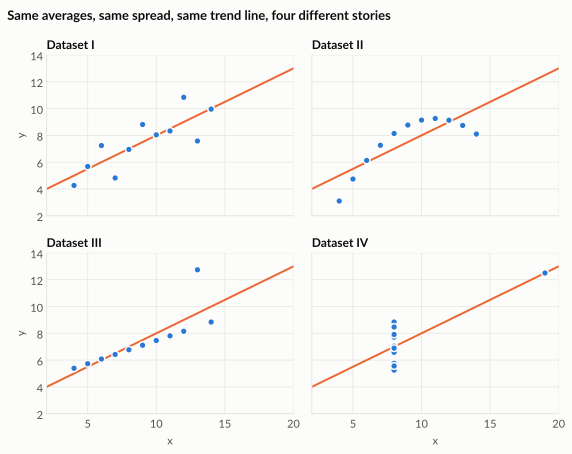
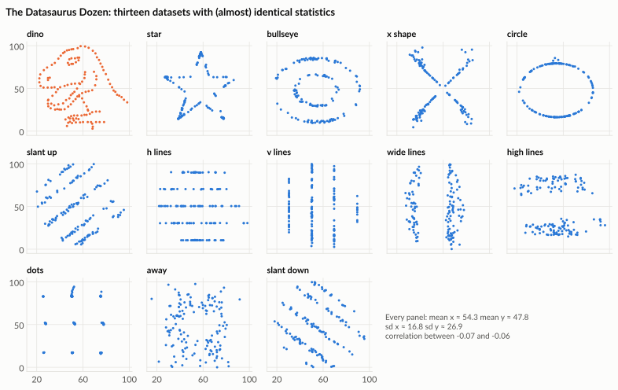

# Statistics are not enough

Averages, spreads and correlations are useful summaries. But very different data can produce exactly the same summary numbers. The only safe habit is to look at the data as well.

---

## Anscombe's quartet

In 1973 the statistician **Francis Anscombe** created four small datasets. Each has eleven points. Look at their summary statistics:

| Statistic | Dataset I | Dataset II | Dataset III | Dataset IV |
|---|---|---|---|---|
| Mean of x | 9.0 | 9.0 | 9.0 | 9.0 |
| Mean of y | 7.50 | 7.50 | 7.50 | 7.50 |
| Variance of x | 11.0 | 11.0 | 11.0 | 11.0 |
| Variance of y | 4.13 | 4.13 | 4.12 | 4.12 |
| Correlation of x and y | 0.816 | 0.816 | 0.816 | 0.817 |
| Best-fit line | y = 3.00 + 0.500x | y = 3.00 + 0.500x | y = 3.00 + 0.500x | y = 3.00 + 0.500x |

If you only read this table, you would say the four datasets are the same. Now look at them:

| Dataset | What the picture shows | What the statistics hide |
|---|---|---|
| **I** | A loose, roughly straight-line relationship | Nothing. This is the case the summary describes well. |
| **II** | A smooth curve | The relationship is not a straight line at all. |
| **III** | A perfect straight line, except for one outlier | A single unusual point drags the trend line. |
| **IV** | Almost all points share one x value; one extreme point creates the "trend" | Remove that one point and every x is the same, so there is no trend left to measure. |

!!! tip "The lesson"

    Summary statistics compress data. Compression throws information away. A chart lets you see what was thrown away.

??? note "The raw data, if you want to plot it yourself"

    | x (I, II, III) | y I | y II | y III | x IV | y IV |
    |---|---|---|---|---|---|
    | 10 | 8.04 | 9.14 | 7.46 | 8 | 6.58 |
    | 8 | 6.95 | 8.14 | 6.77 | 8 | 5.76 |
    | 13 | 7.58 | 8.74 | 12.74 | 8 | 7.71 |
    | 9 | 8.81 | 8.77 | 7.11 | 8 | 8.84 |
    | 11 | 8.33 | 9.26 | 7.81 | 8 | 8.47 |
    | 14 | 9.96 | 8.10 | 8.84 | 8 | 7.04 |
    | 6 | 7.24 | 6.13 | 6.08 | 8 | 5.25 |
    | 4 | 4.26 | 3.10 | 5.39 | 19 | 12.50 |
    | 12 | 10.84 | 9.13 | 8.15 | 8 | 5.56 |
    | 7 | 4.82 | 7.26 | 6.42 | 8 | 7.91 |
    | 5 | 5.68 | 4.74 | 5.73 | 8 | 6.89 |

---

## The Datasaurus Dozen

In 2017, researchers **Justin Matejka and George Fitzmaurice** took the idea further. Starting from a dinosaur drawing made of data points (originally created by Alberto Cairo), they nudged points step by step into new shapes while keeping the summary statistics nearly identical, to about two decimal places.

Every one of these thirteen datasets has:

- mean of x ≈ 54.3 and mean of y ≈ 47.8
- standard deviation of x ≈ 16.8 and of y ≈ 26.9
- correlation between x and y between −0.06 and −0.07

A report that said *"x and y are essentially unrelated, centred around 54 and 48"* would be technically correct for all of them, including the dinosaur.

!!! note "Data source"

    Datasaurus Dozen data from the open-source `datasauRus` package (MIT licence), based on Matejka and Fitzmaurice, *Same Stats, Different Graphs*, ACM CHI 2017.

---

## What this means at work

You will rarely meet a dinosaur in a sales report. But you will meet the same problems in everyday forms:

- **An average hides two very different groups.** Average delivery time looks fine, because most deliveries are fast while a few customers wait weeks.
- **One outlier drives the trend.** A single huge order makes a quiet month look like growth.
- **A relationship is curved, not straight.** Discounts raise sales up to a point, then only cut profit.

!!! warning "Rule of thumb"

    Never report a summary number you have not also looked at in a chart, at least once, yourself.

---

## Try it yourself

!!! hint "Exercise 1: predict, then check"

    Cover the Anscombe chart above. Using only the statistics table, sketch what you think each dataset looks like. Then uncover the chart. Which of your sketches was furthest off, and why?

!!! hint "Exercise 2: find a hidden shape at work"

    Think of a number you see regularly in your job, for example average monthly sales or average response time. Write down two different situations that would produce the **same average** but would need **different decisions**.

!!! hint "Exercise 3: in Tableau (after Lesson 1)"

    Type the Anscombe data from the table above into a spreadsheet with three columns: `dataset` (I, II, III or IV), `x` and `y`, one row per point (44 rows). Connect Tableau to it, then:

    1. Drag `dataset` to **Columns**, then drag `x` to **Columns** to its right.
    2. Drag `y` to **Rows**.
    3. Open the **Analysis** menu and untick **Aggregate Measures**, so each row becomes its own point instead of one summed mark per dataset.

    You have just recreated the quartet.
