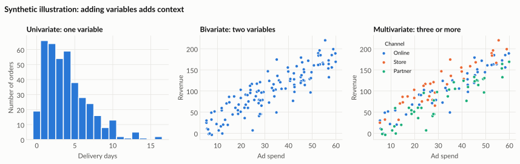

# Types of analysis: one, two or many variables

Most questions start with one variable, then ask how it relates to a second, and finally how several factors work together. Each step needs different summaries and different charts.

*Synthetic data for illustration.*

---

## Univariate analysis: one variable at a time

**Question:** What does this one variable look like?

You describe its **centre** (mean, median), **spread** (range, standard deviation) and **shape** (symmetric, skewed, any outliers).

| Kind of variable | Good summaries | Good charts |
|---|---|---|
| Numbers (sales, days, age) | Mean, median, minimum, maximum, spread | Histogram, box plot |
| Categories (region, product type) | Counts and percentages | Bar chart sorted by size |
| Dates | Counts per day, week or month | Line chart over time |

**Business examples:**

- How long do deliveries usually take, and how long do the slowest ones take?
- Which product category sells most often?
- How many customer complaints arrive each week?

!!! tip "Watch for"

    A skewed shape. In the histogram above, most orders arrive within 1 to 5 days, but a long tail stretches past two weeks. The median (3 days) describes a typical order better than the mean (about 4 days), which the slow tail pulls upward.

---

## Bivariate analysis: two variables together

**Question:** How does one variable change with another?

| The two variables are… | Good summaries | Good charts |
|---|---|---|
| Number and number | Correlation, trend line | Scatter plot |
| Category and number | Mean or median per group | Bar chart, box plot per group |
| Category and category | Counts in a cross-table | Heat map, stacked or grouped bar |
| Date and number | Change over time | Line chart |

**Business examples:**

- Does higher advertising spend go with higher revenue?
- Do some regions have longer delivery times than others?
- Which customer segments buy which product categories?

!!! warning "Remember"

    A relationship between two variables is a **correlation**, not proof of cause. See [How statistics can mislead](misleading-statistics.md).

---

## Multivariate analysis: three or more variables

**Question:** Does the relationship change when we account for something else?

You add a third variable by using **colour**, **size**, **small multiples** (one small chart per group) or **filters**.

**Business examples:**

- Does the link between ad spend and revenue differ by sales channel?
- Do delivery times by region change once we separate standard and express shipping?
- Is a profit drop explained by a change in the product mix?

The second and third panels show exactly the same points. Colouring by channel in the third panel shows that "Store" tends to sit above the others at the same spend, on average. That pattern is invisible in the two-variable chart.

!!! tip "Rule of thumb"

    Add one variable at a time. If a chart needs a long explanation, split it into small multiples instead.

---

## Choosing a chart: quick guide

| I want to show… | Try |
|---|---|
| How values are distributed | Histogram or box plot |
| A ranking | Sorted bar chart |
| Change over time | Line chart |
| Parts of a whole (few parts) | Stacked bar; a pie only for two or three slices |
| Relationship between two numbers | Scatter plot |
| Comparison across many groups | Small multiples or a heat map |
| A single headline number | Just the number, large and clearly labelled |

---

## Try it yourself

!!! hint "Exercise 1: classify the question"

    Is each question univariate, bivariate or multivariate?

    1. What is the typical order value?
    2. Do larger discounts go with lower profit?
    3. Does the discount–profit relationship differ between furniture and office supplies?
    4. How many orders were placed each month?

!!! hint "Exercise 2: pick the chart"

    For each question in Exercise 1, choose a chart type from the quick guide and say in one sentence why.

!!! hint "Exercise 3: your own data"

    Pick one variable from your own work. Write one univariate, one bivariate and one multivariate question you could ask about it.
