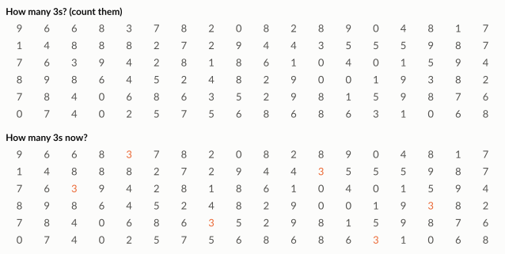
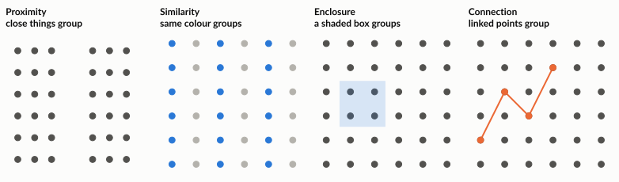

# Designing clear visuals

A good chart lets the reader see the important comparison in seconds. That depends on removing what does not help, and on using what we know about how the eye and brain read pictures.

---

## The data-ink ratio

Information designer **Edward Tufte** suggested a simple test. Of all the ink on a chart, how much actually shows **data**? Everything else (heavy gridlines, borders, shading, 3D effects, decorative colours) is non-data ink. Tufte called unnecessary decoration **chartjunk**.

**Aim:** increase the share of ink that carries data, without removing anything the reader needs.

*Synthetic data for illustration.*

What changed between the two versions:

1. **Removed** the background shading, borders and hatching.
2. **Removed** the gridlines and the value axis, and wrote the values directly on the bars.
3. **Sorted** the bars, so the ranking is obvious.
4. **Used colour once**, to point at the bar that matters.
5. **Turned the bars horizontal**, so labels are easy to read.

!!! warning "Do not overdo it"

    Removing axis labels, units or context to make a chart "clean" makes it less useful. The goal is clarity, not minimalism.

---

## Pre-attentive attributes: what the eye sees first

Some visual differences are noticed almost instantly, before we consciously think. These are called **pre-attentive attributes**. They include colour, size, position, orientation and boldness.

Try it: count the number 3 in the top grid, then in the bottom grid.

The bottom grid takes a second. The top one takes much longer. The only difference is one attribute: colour.

!!! tip "Use this deliberately"

    Make most of the chart grey, then use **one** strong colour or bold label for the thing you want the reader to see. If everything is highlighted, nothing is.

---

## Gestalt principles: how we group things

Our brains automatically group what we see. Designers use these **Gestalt principles** to make related items look related.

| Principle | What it means | Use it in a chart or dashboard |
|---|---|---|
| **Proximity** | Things close together seem related | Put related charts next to each other; leave space between unrelated ones |
| **Similarity** | Things that look alike (colour, shape) seem related | Use the same colour for the same category on every chart |
| **Enclosure** | Things inside a shared border or shaded area seem grouped | Shade a time period, such as a promotion, on a line chart |
| **Connection** | Things joined by a line seem related | Lines connect points in a time series; avoid lines between unrelated categories |
| **Closure** | We complete incomplete shapes in our minds | Charts rarely need full borders; the eye fills them in |
| **Continuity** | We follow smooth paths | Align charts and labels so the eye flows across the page |

---

## Colour with purpose

- **One colour for one meaning.** If "East" is blue in one chart, keep it blue in every chart.
- **Grey for context, colour for focus.**
- **Do not rely on colour alone.** Around one in twelve men has some colour-vision deficiency. Add labels or patterns too.
- **Avoid rainbow palettes** for numbers. Use light-to-dark shades of one colour for "more" and "less".
- **Avoid red and green as the only difference.** It is the most common pair people cannot tell apart.

---

## A clean-chart checklist

1. Does the title say what the reader should notice, not just what is plotted?
2. Are axes labelled with units, and do bars start at zero?
3. Is everything that is not data as light as possible?
4. Is colour used only where it means something?
5. Can someone who cannot see colour still read it?
6. Would a sorted table or a single number be clearer than a chart?

---

## Try it yourself

!!! hint "Exercise 1: declutter"

    Take a chart from a recent report at work, or any chart from the news. List every element that is not data. For each, decide: **keep**, **lighten** or **remove**. Sketch the improved version.

!!! hint "Exercise 2: one highlight"

    Sketch a bar chart of five products where only one product needs attention. Use grey for four bars and one colour for the fifth. Write a title that tells the reader what to notice.

!!! hint "Exercise 3: spot the Gestalt"

    Open any dashboard you use at work. Find one place where **proximity** or **similarity** helps you, and one place where it confuses you.
